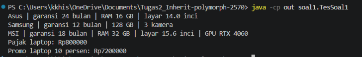
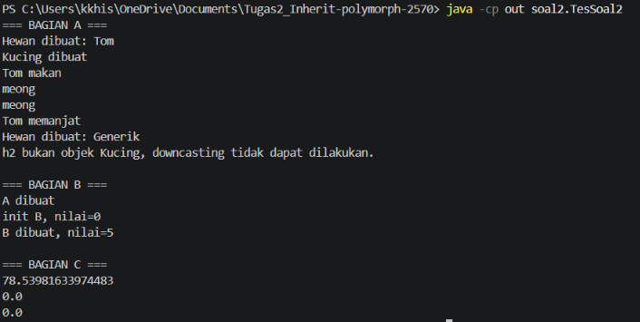
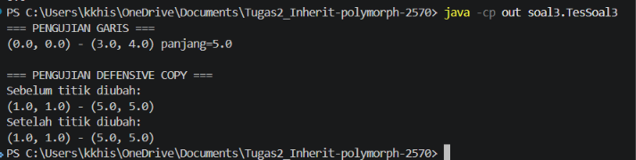
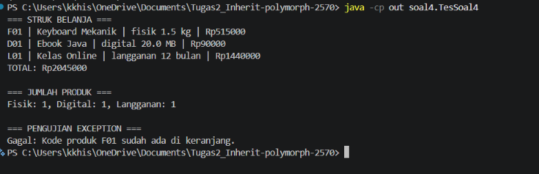

# Tugas 2 Praktikum Pemrograman Berorientasi Objek
## 1. Judul dan Identitas

**Judul:** Tugas 2 inherit polymorph

| Identitas | Keterangan |
|---|---|
| Nama lengkap | **Muhammad Khishal Ardana** |
| NPM | **250810701100070** |
| Kelas praktikum | **A / Pemogramab Beroientasi Objek** |
| Repository | **https://github.com/khishal/Tugas2_Inherit-polymorph-2570.git** |

Nama repository: `Tugas2_Inherit-polymorph-2570`

## 2. Deskripsi Singkat

Project ini berisi penyelesaian empat soal praktikum Pemrograman Berorientasi Objek menggunakan Java. Soal-soal tersebut membahas inheritance, overriding, casting, dynamic method dispatch, composition, aliasing, defensive copy, abstract class, polymorphism, dan exception handling.

## 3. Fitur Utama

### Soal 1 — Inheritance Perangkat Elektronik
- Menampilkan informasi laptop, ponsel, dan laptop gaming.
- Menghitung pajak perangkat dan harga promo laptop.
- Menambahkan informasi khusus pada subclass, seperti RAM, kapasitas penyimpanan, kamera, GPU, dan garansi.
- Menunjukkan penggunaan atribut `protected` dari subclass.

### Soal 2 — Overriding, Casting, dan Constructor
- Menguji overriding method `suara()` pada `Kucing`.
- Menguji upcasting dan downcasting antara `Hewan` dan `Kucing`.
- Memperlihatkan `ClassCastException` ketika objek `Hewan` dipaksa menjadi `Kucing`.
- Menguji urutan pemanggilan constructor superclass dan subclass.
- Menguji dynamic method dispatch pada `Lingkaran` dan `Titik`.

### Soal 3 — Composition: Titik dan Garis
- Membuat titik berdasarkan koordinat dua dimensi.
- Menghitung jarak antara dua titik dan panjang garis.
- Membuat garis melalui dua objek `Titik`.
- Menguji aliasing dan defensive copy ketika titik asal diubah.

### Soal 4 — Mini Project Toko Digital
- Menyediakan produk fisik, produk digital, dan produk langganan.
- Menghitung harga akhir sesuai jenis produk.
- Menyimpan beberapa produk dalam keranjang belanja.
- Menampilkan struk dan total belanja.
- Menghitung jumlah produk berdasarkan jenis.
- Menolak kode produk duplikat dengan exception.

## 4. Konsep OOP yang Diterapkan

| Konsep | Penerapan pada project | Alasan penggunaan |
|---|---|---|
| Inheritance | `Laptop`, `Ponsel`, dan `LaptopGaming` mewarisi `Perangkat`; `Kucing` mewarisi `Hewan` | Menggunakan kembali atribut dan perilaku kelas induk pada kelas yang lebih khusus |
| Overriding | `infoSingkat()`, `suara()`, `luas()`, `keliling()`, dan `hitungHargaAkhir()` | Memberikan perilaku yang sesuai dengan jenis objek |
| Upcasting | `Hewan h = new Kucing("Tom")` | Memperlakukan objek subclass melalui tipe superclass |
| Downcasting | Casting `Hewan` menjadi `Kucing` setelah pemeriksaan `instanceof` | Mengakses perilaku khusus subclass dengan pemeriksaan tipe agar aman |
| Dynamic method dispatch | Pemanggilan `h.suara()` dan `l3.luas()` | Method yang dijalankan mengikuti tipe objek sebenarnya saat runtime |
| Constructor dan `super()` | Constructor subclass memanggil constructor superclass | Memastikan bagian superclass dari objek diinisialisasi |
| Composition | `Garis` menyimpan dua objek `Titik`; `Keranjang` menyimpan daftar `Produk` | Memodelkan objek yang tersusun dari atau memiliki objek lain |
| Constructor overloading | Constructor `Titik` dan `Garis` memiliki variasi parameter | Menyediakan beberapa cara untuk membuat objek |
| Aliasing | Variabel `t` dan titik yang diteruskan ke constructor `Garis` dapat merujuk objek yang sama pada versi awal | Menunjukkan dampak beberapa referensi terhadap satu objek |
| Defensive copy | Constructor dan getter `Garis` membuat salinan `Titik` | Melindungi data internal agar tidak berubah melalui referensi dari luar |
| Abstract class | `Produk` menjadi kelas abstrak dengan method abstrak | Menetapkan kontrak yang harus diterapkan oleh jenis produk |
| Polymorphism | `Keranjang` memproses objek melalui tipe `Produk` | Memungkinkan satu alur program menangani beberapa subclass |
| Exception handling | `try-catch` pada pengujian kode produk duplikat dan skenario casting | Menangani kondisi kesalahan agar dapat dijelaskan atau ditangani program |

## 5. Struktur Project

```text
Tugas2_Inherit-polymorph-2570/
├── src/
│   ├── soal1/
│   │   ├── Perangkat.java
│   │   ├── Laptop.java
│   │   ├── Ponsel.java
│   │   ├── LaptopGaming.java
│   │   └── TesSoal1.java
│   ├── soal2/
│   │   ├── Hewan.java
│   │   ├── Kucing.java
│   │   ├── A.java
│   │   ├── B.java
│   │   ├── Lingkaran.java
│   │   ├── Titik.java
│   │   └── TesSoal2.java
│   ├── soal3/
│   │   ├── Titik.java
│   │   ├── Garis.java
│   │   └── TesSoal3.java
│   └── soal4/
│       ├── Produk.java
│       ├── ProdukFisik.java
│       ├── ProdukDigital.java
│       ├── Langganan.java
│       ├── Keranjang.java
│       └── TesSoal4.java
├── screenshot/ 
│   ├── soal1.png
│   ├── soal2.png
│   ├── soal3.png
│   └── soal4.png
│
├── .gitignore
├── LICENSE
└── README.md
```

Setiap folder `soal1` sampai `soal4` merupakan package terpisah. Kelas dengan nama sama pada package berbeda, seperti `Titik`, tidak saling bertabrakan karena berada pada package yang berbeda.

## 6. Prasyarat

- **JDK:** gunakan JDK yang terpasang pada komputer. Catat versi aktual melalui perintah `java -version` dan `javac -version`.
- **IDE:** IntelliJ IDEA disarankan untuk mengikuti konfigurasi run pada bagian berikut.
- **Terminal:** Command Prompt, PowerShell, atau terminal bawaan IDE.

Contoh pemeriksaan versi:

```bash
java -version
javac -version
```

Versi JDK yang digunakan saat pengujian: **[Isi berdasarkan hasil perintah di komputer]**.

## 7. Cara Menjalankan Program

### A. Menjalankan melalui IntelliJ IDEA

1. Ekstrak project dan buka IntelliJ IDEA.
2. Pilih **File → Open**, lalu pilih folder utama `Tugas2_Inherit-polymorph-2570`.
3. Pastikan JDK sudah terpasang dan dipilih melalui **File → Project Structure → Project SDK**.
4. Tandai folder `src` sebagai **Sources Root** jika belum dikenali otomatis.
5. Buka salah satu kelas pengujian:
   - `src/soal1/TesSoal1.java`
   - `src/soal2/TesSoal2.java`
   - `src/soal3/TesSoal3.java`
   - `src/soal4/TesSoal4.java`
6. Klik ikon Run di samping method `main()` atau klik kanan file, lalu pilih **Run 'TesSoal...'**.
7. Untuk membuat konfigurasi secara manual, buka **Run → Edit Configurations → + → Application**. Isi:
   - **Name:** nama soal, misalnya `TesSoal1`
   - **Main class:** `soal1.TesSoal1` (sesuaikan dengan soal yang dijalankan)
   - **Use classpath of module:** pilih module project
8. Klik **Apply → OK**, kemudian jalankan konfigurasi tersebut.

Ulangi langkah yang sama untuk kelas pengujian soal lainnya dengan mengganti Main class.

### B. Menjalankan melalui Command Line

Jalankan perintah dari direktori utama project.

**1. Kompilasi seluruh package:**

```bash
javac -d out src/soal1/*.java src/soal2/*.java src/soal3/*.java src/soal4/*.java
```

**2. Jalankan masing-masing soal:**

```bash
java -cp out soal1.TesSoal1
java -cp out soal2.TesSoal2
java -cp out soal3.TesSoal3
java -cp out soal4.TesSoal4
```

Folder `out` berisi hasil kompilasi `.class`. Folder tersebut dibuat saat kompilasi dan tidak perlu disertakan dalam ZIP pengumpulan.

## 8. Contoh Output

### Soal 1 — Output normal

```text
Asus | garansi 24 bulan | RAM 16 GB | layar 14.0 inci
Samsung | garansi 12 bulan | 128 GB | 3 kamera
MSI | garansi 18 bulan | RAM 32 GB | layar 15.6 inci | GPU RTX 4060
Pajak laptop: Rp800000
Promo laptop 10 persen: Rp7200000
```

Screenshot: `docs/screenshots/soal1.png`



### Soal 2 — Output normal

Bagian A menggunakan pemeriksaan `instanceof` agar program dapat melanjutkan ke Bagian B dan C.

```text
=== BAGIAN A ===
Hewan dibuat: Tom
Kucing dibuat
Tom makan
meong
meong
Tom memanjat
Hewan dibuat: Generik
h2 bukan objek Kucing, downcasting tidak dapat dilakukan.

=== BAGIAN B ===
A dibuat
init B, nilai=0
B dibuat, nilai=5

=== BAGIAN C ===
78.53981633974483
0.0
0.0
```




**Skenario exception casting:** pada versi asli, baris `Kucing k2 = (Kucing) h2;` menghasilkan `ClassCastException`, karena `h2` merujuk objek yang dibuat dari `new Hewan("Generik")`, bukan objek `Kucing`.


### Soal 3 — Output normal dan defensive copy

```text
=== PENGUJIAN GARIS ===
(0.0, 0.0) - (3.0, 4.0) panjang=5.0

=== PENGUJIAN DEFENSIVE COPY ===
Sebelum titik diubah:
(1.0, 1.0) - (5.0, 5.0)
Setelah titik diubah:
(1.0, 1.0) - (5.0, 5.0)
```




### Soal 4 — Output normal dan exception tertangani

```text
=== STRUK BELANJA ===
F01 | Keyboard Mekanik | fisik 1.5 kg | Rp515000
D01 | Ebook Java | digital 20.0 MB | Rp90000
L01 | Kelas Online | langganan 12 bulan | Rp1440000
TOTAL: Rp2045000

=== JUMLAH PRODUK ===
Fisik: 1, Digital: 1, Langganan: 1

=== PENGUJIAN EXCEPTION ===
Gagal: Kode produk F01 sudah ada di keranjang.
```

Screenshot: `docs/screenshots/soal4.png`




## 9. Jawaban Soal dan Analisis Konsep

### A. Soal 1 — Pertanyaan tambahan

**Apa yang terjadi jika atribut `harga` pada `Perangkat` diubah dari `protected` menjadi `private`?**

Subclass `Laptop` tidak dapat mengakses atribut `harga` secara langsung karena atribut `private` hanya dapat diakses dari dalam kelas yang mendeklarasikannya. Jika kode subclass masih mengakses `harga` secara langsung, kompilasi akan gagal. Solusinya adalah menyediakan method getter pada `Perangkat`, lalu subclass mengambil nilai melalui getter tersebut.

### B. Soal 2 — Pertanyaan 1 sampai 6

**1. Tuliskan output lengkap program sampai program berhenti.**

Pada program asli, urutan output sampai program berhenti adalah:

```text
Hewan dibuat: Tom
Kucing dibuat
Tom makan
meong
meong
Tom memanjat
Hewan dibuat: Generik
```

Setelah itu terjadi `ClassCastException` pada baris `Kucing k2 = (Kucing) h2;`. Program berhenti karena objek yang dirujuk `h2` merupakan objek `Hewan`, bukan objek `Kucing`.

**2. Jika komentar pada `h.panjat()` dihapus, error apa yang muncul?**

Terjadi compile-time error atau kesalahan kompilasi. Tipe statis variabel `h` adalah `Hewan`, sedangkan method `panjat()` tidak dideklarasikan di kelas `Hewan`. Karena itu, pemanggilan `h.panjat()` tidak dapat dikenali oleh compiler, walaupun objek sebenarnya adalah `Kucing`.

**3. Baris mana yang menyebabkan `ClassCastException`? Perbaiki dengan `instanceof` tanpa mengubah tipe variabel `h2`.**

Baris penyebabnya:

```java
Kucing k2 = (Kucing) h2;
```

Perbaikan:

```java
Hewan h2 = new Hewan("Generik");

if (h2 instanceof Kucing) {
    Kucing k2 = (Kucing) h2;
    k2.panjat();
} else {
    System.out.println("h2 bukan objek Kucing, downcasting tidak dapat dilakukan.");
}
```

Tipe variabel `h2` tetap `Hewan`. Pemeriksaan `instanceof` memastikan casting hanya dilakukan jika objek memang merupakan instance `Kucing`.

**4. Pada `h.makan()`, method `suara()` milik kelas mana yang dijalankan?**

Method `suara()` milik `Kucing` yang dijalankan. Tipe statis variabel `h` adalah `Hewan`, tetapi tipe dinamis objek yang dirujuk adalah `Kucing`. Karena `suara()` dioverride, Java memilih implementasi berdasarkan tipe objek saat runtime.

**5. Prediksi output `new B()` dan mengapa nilai pada `init B` bukan 5?**

Output:

```text
A dibuat
init B, nilai=0
B dibuat, nilai=5
```

Constructor `A` memanggil method `init()`. Karena objek yang sedang dibuat adalah `B`, implementasi `init()` milik `B` dipanggil. Namun, pemanggilan terjadi sebelum inisialisasi atribut instance `nilai = 5` pada `B`, sehingga nilai default `int`, yaitu `0`, masih terlihat. Memanggil method yang dapat dioverride dari constructor berisiko menjalankan kode subclass ketika atribut subclass belum selesai diinisialisasi.

**6. Mengapa `l3.luas()` menghasilkan `0.0` dan apakah relasi is-a tersebut masuk akal?**

`l3` bertipe variabel `Lingkaran`, tetapi objek yang dibuat adalah `new Titik()`. Method yang dijalankan mengikuti tipe dinamis objek, sehingga `Titik.luas()` menghasilkan `0.0`. Relasi “Titik adalah Lingkaran” tidak masuk akal karena titik bukan jenis lingkaran. Jika method menerima `Lingkaran` dan mengasumsikan luas selalu lebih dari nol, objek `Titik` dapat melanggar asumsi tersebut dan menghasilkan perilaku yang tidak diharapkan.

## C. Soal 3 — Composition, Aliasing, dan Defensive Copy

### 1. Apa yang tercetak pada baris kedua dan mengapa? (Prediksi sebelum perbaikan)

Sebelum defensive copy diterapkan, baris kedua akan menampilkan:

```text
(100.0, 1.0) - (5.0, 5.0)
```

Hal ini terjadi karena objek `Garis` menyimpan referensi ke objek `Titik` yang sama dengan variabel `t`. Ketika `t.setX(100)` dipanggil, koordinat titik awal yang digunakan oleh `Garis` juga berubah. Perilaku ini disebut *aliasing*, yaitu beberapa referensi menunjuk ke objek yang sama.

### 2. Ubah constructor Garis agar perubahan objek luar tidak memengaruhi isi Garis (defensive copy). Setelah diperbaiki, apa yang tercetak?

Constructor `Garis` perlu membuat salinan objek `Titik`, bukan menyimpan referensi objek aslinya.

Contoh perbaikannya:

```java
public Garis(Titik awal, Titik akhir) {
    this.awal = new Titik(awal.getX(), awal.getY());
    this.akhir = new Titik(akhir.getX(), akhir.getY());
}
```

Setelah defensive copy diterapkan, output menjadi:

```text
(1.0, 1.0) - (5.0, 5.0)
```

Koordinat tetap karena `Garis` menyimpan salinan objek `Titik`. Perubahan pada objek `t` dari luar tidak memengaruhi titik yang tersimpan di dalam `Garis`.

### 3. Kapan perilaku sebelum perbaikan justru lebih tepat, dan kapan sesudah perbaikan lebih tepat?

- **Sebelum perbaikan (aliasing):** lebih tepat ketika beberapa bagian program memang perlu menggunakan dan memodifikasi objek yang sama secara bersama-sama. Perubahan pada satu referensi akan langsung terlihat oleh referensi lainnya.
- **Sesudah perbaikan (defensive copy):** lebih tepat ketika kelas perlu melindungi data internalnya agar tidak berubah akibat modifikasi objek dari luar. Contohnya pada objek `Garis` yang harus mempertahankan koordinat titik awal dan akhirnya.

### 4. Seandainya Garis dibuat dengan `extends Titik`, masalah desain apa yang muncul ditinjau dari relasi is-a dan has-a?

Jika `Garis extends Titik`, desain tersebut tidak tepat karena garis bukan merupakan sebuah titik. Hubungan *is-a* menyatakan bahwa objek subclass merupakan jenis dari superclass, sedangkan garis tidak bisa dianggap sebagai jenis titik.

Hubungan yang lebih tepat adalah *has-a* karena garis memiliki dua titik, yaitu titik awal dan titik akhir. Oleh karena itu, `Garis` sebaiknya menggunakan composition dengan menyimpan dua objek `Titik`, bukan mewarisi kelas `Titik`.

**Catatan implementasi:** agar defensive copy benar-benar melindungi data internal, getter `getAwal()` dan `getAkhir()` juga perlu mengembalikan salinan objek `Titik`, bukan referensi internal secara langsung.


### D. Tiga poin analisis konsep

1. **Inheritance dan overriding:** inheritance memungkinkan subclass menggunakan atribut dan method superclass, sedangkan overriding memungkinkan subclass menyediakan perilaku yang lebih spesifik. Keduanya digunakan ketika terdapat hubungan pewarisan yang masuk akal.
2. **Polymorphism dan dynamic method dispatch:** referensi superclass dapat menunjuk objek subclass. Method yang dioverride akan dijalankan sesuai objek sebenarnya saat runtime, seperti pemanggilan `h.suara()` yang menjalankan `Kucing.suara()`.
3. **Composition dan encapsulation:** composition membentuk objek dari objek lain, seperti `Garis` yang memiliki dua `Titik`. Defensive copy membantu menjaga encapsulation dengan mencegah perubahan data internal melalui referensi luar.

## 10. Batasan dan Pengembangan Lanjutan

- Project menggunakan data pengujian yang dibuat langsung di kelas `TesSoal1` sampai `TesSoal4`.
- Project belum menggunakan database untuk menyimpan data.
- Project belum memiliki antarmuka pengguna grafis.
- Mini project toko digital masih menggunakan aturan harga dan data produk sederhana.
- Pengembangan selanjutnya dapat mencakup penyimpanan data, antarmuka pengguna, pengelolaan jumlah barang, serta pengujian otomatis.

